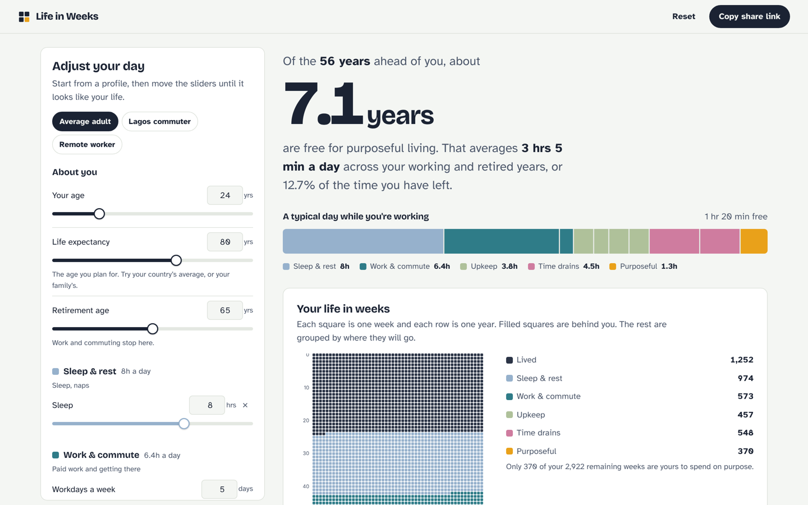

# Life in Weeks

How much of the rest of your life is actually yours?

Life in Weeks lets you set how long you sleep, work, commute, cook, clean, eat and scroll. It then shows how much of your remaining life is left for **purposeful living**: investing in yourself, your craft, your people, or whatever you were born to do.

**Live demo:** _add your Vercel URL here after deploying_



## Features

- **Every variable is adjustable.** Age, life expectancy, retirement age, workdays a week, and hours for each activity. Each one has a slider and an exact number box.
- **Realistic model.** Work and commuting only happen on workdays and stop when you retire. Everything else continues for life. Leap years are counted (365.25 days a year).
- **Profiles to start from:** average adult, Lagos commuter and remote worker.
- **Your life in weeks.** A calendar of every week of your life (52 squares a row, one row a year). Past weeks are filled in, and the remaining weeks are grouped by where they go.
- **Take some time back.** A what-if slider shows how much purposeful time you gain by cutting time drains, and can apply the cut to your day.
- **Add your own activities** (gym, church, side hustle, gaming), counted as upkeep, rest, work or a time drain, every day or on workdays only.
- **Plain-language insights**, generated from your numbers.
- **Share link.** Your whole setup is encoded in the URL. Nothing is stored on a server.
- **Remembers your last setup** in your browser (localStorage).
- Responsive down to small phones, keyboard accessible, light and dark mode, respects reduced motion.

## How it's calculated

```
years left        = life expectancy − age
working years     = min(retirement age, life expectancy) − age   (never below 0)
retired years     = years left − working years

workday activity  = hours × workdays per week ÷ 7   (an average per calendar day)
free hours a day  = 24 − sum of all activities       (worked out separately for
                                                     working and retired years)
purposeful time   = free hours × days in each phase
```

If your day adds up to more than 24 hours, the app tells you how much to cut instead of showing a negative number.

The starting hours are round averages for a working adult, **not survey data**. Change them to match a real week.

## Tech

- Plain HTML, CSS and JavaScript (ES modules). **No framework, no build step and no runtime dependencies.**
- All calculations live in pure, tested modules (`src/model.js`, `src/state.js`, `src/format.js`); the UI (`src/main.js`, `src/grid.js`) only renders.
- Unit tests with Node's built-in test runner, run on every push by GitHub Actions.
- Security: a strict Content-Security-Policy (`script-src 'self'`, no third-party requests), self-hosted fonts, user-entered text is always rendered as text (never HTML), and share links are validated and clamped before use.

```
index.html          page structure
src/model.js        calculation engine (pure)
src/state.js        defaults, presets, validation, share-link encoding
src/format.js       number and duration formatting
src/main.js         UI: controls, rendering, events
src/grid.js         the life-in-weeks canvas
src/styles.css      styles (light and dark)
tests/              unit tests (node --test)
fonts/              Bricolage Grotesque and Atkinson Hyperlegible (SIL OFL)
vercel.json         security headers and caching
```

## Run locally

ES modules need a local web server (opening `index.html` directly won't work).

```bash
npm start            # serves on http://localhost:3000
# or
python -m http.server 3000
```

## Tests

```bash
npm test
```

Requires Node 20 or newer. There is nothing to install.

## Deploy to Vercel

1. Push this repository to GitHub.
2. In Vercel, click **Add New → Project** and import the repository.
3. Leave **Framework Preset** as **Other**, with no build command, and click **Deploy**.

`vercel.json` adds the security headers.

## Credits

Built by Oladeji Victor Enoch. It grew out of a small `lifeInWeeks(age)` JavaScript exercise, extended into a full model of where your time goes.

Fonts: [Bricolage Grotesque](https://fonts.google.com/specimen/Bricolage+Grotesque) and [Atkinson Hyperlegible](https://fonts.google.com/specimen/Atkinson+Hyperlegible), under the SIL Open Font License.

## License

MIT
